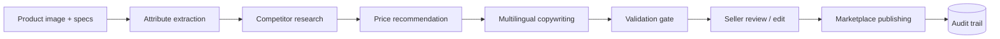

# 🦊 Kitsunecart — Autonomous E-commerce Listing Platform

Turn a **product photo + rough specs** into a **marketplace-ready listing**:
attributes extracted from the image, competitor research, a defensible price,
multilingual copy (English, Hindi and regional Indian languages), a validation
gate, and a reviewable publication step — with a complete audit trail.

This repository started as a 50 KB engineering prompt. That prompt is the
**specification**; this codebase is the implementation of it, and the prompt
is preserved in `specs/` for reference.

Built for Indian marketplace sellers (Amazon India, Flipkart, Meesho).

## How it works



Every stage writes an audit event, so a seller can see what the platform
inferred, what the market looked like, and why a price was chosen.

## Design principles (from the spec)

- Production quality over demo quality; strong typing; modular boundaries.
- **Ports and adapters** — LLM, vision, research and marketplace publishing
  sit behind protocols, so a new provider is added without touching the domain.
- **Idempotency** — an `Idempotency-Key` replays the stored listing instead
  of re-running the expensive stages.
- **Retry safety** — publication attempts are keyed per
  listing/marketplace/language.
- **Database migrations** — schema changes are versioned and applied on start.
- **Observability** — JSONL audit trail per listing.
- **API versioning** — everything lives under `/api/v1`.

## Quick start

```bash
python -m venv .venv && source .venv/bin/activate   # Windows: .venv\Scripts\activate
pip install -r requirements-dev.txt

uvicorn app.api:app --reload
```

Out of the box the service runs on **mock providers** — no API keys needed,
fully deterministic, which is also what the test suite uses. To switch to the
production providers, set in `.env`:

| Variable | Effect |
|---|---|
| `LLM_PROVIDER=groq` + `GROQ_API_KEY` | Groq writes the listing copy |
| `VISION_PROVIDER=openai` + `OPENAI_API_KEY` | A vision model reads the product image |
| `PUBLISH_ENABLED=true` | Publication runs as part of the pipeline |

## API

| Method | Route | Purpose |
|---|---|---|
| `GET` | `/health` | Liveness |
| `GET` | `/ready` | Readiness (pings the database, reports the active providers) |
| `POST` | `/api/v1/listings` | Run the pipeline for a product → listing draft |
| `GET` | `/api/v1/listings` | Recent listings, newest first |
| `GET` | `/api/v1/listings/{id}` | One listing with content, price, validation and audit |
| `GET` | `/api/v1/listings/{id}/audit` | The full audit trail |
| `POST` | `/api/v1/listings/{id}/publish` | Publish an approved listing |

Set `API_KEY` to require an `X-API-Key` header on the write routes (401
otherwise). `BACKEND_ORIGINS` is an explicit CORS allowlist.

```bash
curl -X POST localhost:8000/api/v1/listings \
  -H "Content-Type: application/json" \
  -H "Idempotency-Key: order-1234" \
  -d '{
        "product": {"title_hint": "Cotton Bed Sheet", "brand": "Nimbus",
                    "image_path": "data/uploads/bed-sheet.jpg"},
        "languages": ["en", "hi"],
        "marketplaces": ["amazon_in", "meesho"]
      }'
```

## Validation rules

A listing is only publishable when it satisfies the marketplace contract:

- title between 1 and 200 characters
- 3–5 bullets, each at most 250 characters
- description of at least 80 characters
- non-Latin languages really use their script (a Hindi listing must contain
  Devanagari)
- the recommended price sits inside the researched floor/ceiling band

Failing listings are marked `REJECTED` with the reasons attached, and the
publish endpoint refuses them with 422.

## Pricing

The price recommendation is derived from the observed market, not invented:

```
median(competitor prices) -> recommended = median x (1 - target_margin)
                            floor      = median x 0.80
                            ceiling    = median x 1.25
```

With no competitor data the platform returns an explicit default band and
says so in the rationale, rather than pretending to know the market.

## Layout

```text
app/domain.py       entities, enums and the validation rules (no infrastructure)
app/providers.py    ports + adapters: LLM, vision, research, marketplace publishing
app/store.py        SQLite store, schema migrations, audit trail
app/pipeline.py     the stage orchestration and the pricing model
app/api.py          FastAPI surface (v1)
specs/              the original engineering prompt this was built from
tests/              offline, deterministic tests
```

## Testing

```bash
python -m pytest tests -q     # 18 tests, no network, no API keys
ruff check app tests
```

CI runs lint, the test suite, and a hardened Docker build that asserts the
runtime image has no compiler and answers `/health` as a non-root user.

## Deployment notes

- Persist `data/` (SQLite + uploads) on a volume; the store runs in WAL mode.
- Keep provider credentials in the environment or a secret store — never in
  the image.
- Real marketplace adapters (Amazon SP-API, Flipkart Partner, Meesho) need
  seller accounts; they implement the same `MarketplacePublisher` protocol as
  the sandbox adapter used here.
